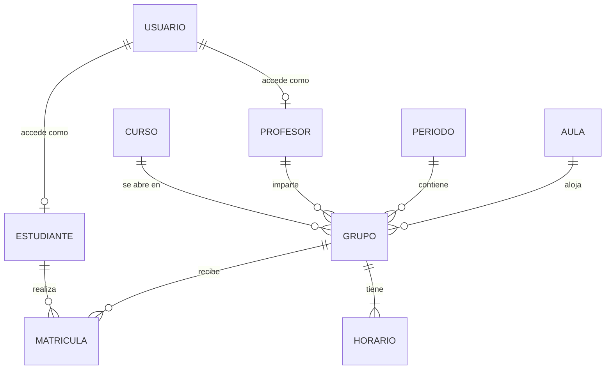

# Sistema de Matrícula — Documento de Requerimientos

## 1. Descripción general

### 1.1 Propósito
Este sistema gestiona la matrícula de un instituto que ofrece cursos libres de computación. El instituto ofrece varios cursos y de cada uno abre una cantidad variable de grupos según la demanda.

Para que un estudiante se pueda matricular en un grupo, se deben cumplir dos condiciones:
- El estudiante debe estar registrado en el instituto.
- El grupo debe estar abierto y tener cupo.

### 1.2 Objetivos
- Centralizar la información de estudiantes, profesores, cursos, grupos, aulas y periodos académicos.
- Automatizar el proceso de matrícula, retiro y cambio de grupo, aplicando las reglas del instituto.
- Evitar los choques de horario de estudiantes, profesores y aulas.
- Dar a cada tipo de usuario acceso solo a la información y las acciones que le corresponden.
- Ofrecer consultas y listados para la gestión académica.

### 1.3 Alcance
**Incluido:**
- Registro de usuarios: registro público de estudiantes, y registro de estudiantes, profesores y administradores por parte de un administrador.
- Inicio de sesión, contraseñas temporales enviadas por correo con cambio obligatorio al ingresar, olvido de contraseña y cambio de contraseña desde el perfil.
- Control de acceso por roles.
- Gestión de estudiantes, profesores, cursos, periodos académicos, aulas, grupos y horarios.
- Proceso de matrícula, retiro y cambio de grupo.
- Consultas y listados académicos.

**Fuera del alcance de esta versión** (posibles mejoras futuras):
- Calificaciones e historial académico.
- Prerrequisitos entre cursos.
- Lista de espera para grupos llenos.
- Pagos y facturación.
- Control de asistencia.
- Emisión de certificados.
- Reportes estadísticos (ocupación, demanda, ingresos).
- Auditoría detallada de cambios.
- Uso de enlaces de un solo uso enviados por correo, en lugar de contraseñas temporales, tanto para activar cuentas nuevas como para el olvido de contraseña.

---

## 2. Roles del sistema

| Rol | Descripción |
|---|---|
| **Administrador** | Personal administrativo del instituto. Tiene control total: gestiona todos los catálogos, abre y cierra grupos, y puede matricular, retirar o cambiar de grupo a cualquier estudiante. Es el único que puede registrar profesores y otros administradores. También puede registrar estudiantes. |
| **Profesor** | Docente del instituto. Consulta los grupos que tiene asignados, sus horarios y los estudiantes matriculados en ellos. Su cuenta solo la puede crear un administrador. |
| **Estudiante** | Persona registrada en el instituto. Consulta la oferta de grupos abiertos, se matricula, se retira o cambia de grupo, y ve su propia matrícula y su horario. Puede registrarse por su cuenta o ser registrado por un administrador. |
| **Visitante** *(sin sesión)* | Persona que todavía no ha iniciado sesión. Solo puede registrarse como estudiante, iniciar sesión, solicitar una contraseña temporal si olvidó la suya y consultar la oferta académica (RF-50). |

### 2.1 Formas de registro por rol

| Rol | ¿Quién lo registra? | Contraseña inicial |
|---|---|---|
| Estudiante | El propio estudiante, mediante el registro público | La define el estudiante al registrarse |
| Estudiante | Un administrador, por ejemplo si el estudiante no sabe usar el sistema | Temporal, generada por el sistema y **enviada al correo** de la persona; se debe cambiar en el primer ingreso |
| Profesor | Solo un administrador | Temporal, generada por el sistema y **enviada al correo** de la persona; se debe cambiar en el primer ingreso |
| Administrador | Solo otro administrador. El primero se crea automáticamente al instalar el sistema | Temporal, generada por el sistema y **enviada al correo** de la persona; se debe cambiar en el primer ingreso. La del primer administrador se define en la configuración inicial |

> El administrador **nunca ve ni conoce** la contraseña de otra persona. Las contraseñas temporales solo se envían al correo del usuario.

### 2.2 Matriz de permisos

| Funcionalidad | Visitante | Administrador | Profesor | Estudiante |
|---|:---:|:---:|:---:|:---:|
| Registrarse como estudiante | ✔ | — | — | — |
| Iniciar sesión y solicitar una contraseña temporal por olvido | ✔ | — | — | — |
| Cambiar la contraseña propia y consultar el perfil propio | — | ✔ | ✔ | ✔ |
| Registrar estudiantes | — | ✔ | — | — |
| Registrar profesores y administradores | — | ✔ | — | — |
| Reenviar una contraseña temporal a otro usuario | — | ✔ | — | — |
| Activar o desactivar usuarios | — | ✔ | — | — |
| Gestionar estudiantes | — | ✔ | — | Solo ver y editar sus datos de contacto |
| Gestionar profesores | — | ✔ | — | — |
| Gestionar cursos | — | ✔ | Consultar | Consultar |
| Gestionar periodos académicos | — | ✔ | Consultar | Consultar |
| Gestionar aulas | — | ✔ | Consultar | — |
| Gestionar grupos y horarios | — | ✔ | Consultar los suyos | Consultar los abiertos |
| Consultar la oferta académica | ✔ | ✔ | ✔ | ✔ |
| Cambiar el estado de un grupo | — | ✔ | — | — |
| Matricular, retirar o cambiar de grupo | — | ✔ (a cualquier estudiante) | — | ✔ (solo a sí mismo) |
| Ver los estudiantes de un grupo | — | ✔ | Solo de sus grupos | — |
| Ver los cursos matriculados de un estudiante | — | ✔ | — | Solo los suyos |
| Ver los grupos asignados a un profesor | — | ✔ | Solo los suyos | — |

---

## 3. Requerimientos funcionales

### 3.1 Registro de usuarios
- **RF-01 Registro público de estudiantes:**
  - Cualquier persona puede registrarse, sin iniciar sesión.
  - Proporciona sus datos personales (cédula, nombre, apellidos, teléfono, correo) y define su contraseña.
  - El sistema crea a la vez la cuenta y el registro del estudiante, y le asigna **siempre** el rol Estudiante.
  - El registro público no permite indicar el rol (RN-19).
- **RF-02 Registro de estudiantes por un administrador:**
  - Pensado para estudiantes que no saben usar el sistema o que se registran de forma presencial.
  - El administrador proporciona los datos del estudiante.
  - El sistema crea la cuenta con rol Estudiante y genera una contraseña temporal (RF-05).
- **RF-03 Registro de profesores por un administrador:**
  - El administrador proporciona los datos del profesor.
  - El sistema crea la cuenta con rol Profesor y genera una contraseña temporal (RF-05).
- **RF-04 Registro de administradores por otro administrador:**
  - El sistema crea la cuenta con rol Administrador y genera una contraseña temporal (RF-05).
  - El primer administrador se crea automáticamente al instalar el sistema, también con una contraseña temporal.
- **RF-05 Generar y enviar una contraseña temporal:**
  - El sistema genera una contraseña aleatoria y la **envía al correo** registrado de la persona.
  - Nadie más la ve; tampoco el administrador.
  - Este mismo mecanismo se usa en tres casos:
    - Cuentas creadas por un administrador (RF-02, RF-03 y RF-04).
    - Olvido de contraseña (RF-10).
    - Reenvío por parte de un administrador (RF-12).

### 3.2 Acceso y gestión de contraseñas
- **RF-06 Iniciar sesión:** el usuario se autentica con su correo y contraseña. Según su rol, accede a distintas funcionalidades.
- **RF-07 Cambio obligatorio de contraseña al ingresar con una temporal:**
  - Cuando el usuario inicia sesión con una contraseña temporal, ya sea en su primer ingreso o después de un olvido, el sistema le exige definir una nueva contraseña antes de continuar.
  - Para el cambio proporciona la **nueva contraseña** y su **confirmación**.
  - Hasta completar el cambio, el sistema le rechaza cualquier otra funcionalidad (RN-24).
- **RF-08 Cerrar sesión.**
- **RF-09 Cambiar la contraseña propia:**
  - Cualquier usuario con sesión puede cambiar su contraseña.
  - Proporciona la **contraseña actual**, la **nueva contraseña** y la **confirmación** de la nueva.
  - Al completarse, el sistema envía un correo de aviso informando que la contraseña fue cambiada.
- **RF-10 Olvido de contraseña:**
  - Cualquier persona sin sesión puede solicitarlo indicando un correo.
  - Si el correo pertenece a una cuenta activa, el sistema le envía una contraseña temporal (RF-05) que **vence en 1 hora**.
  - La respuesta es siempre la misma, exista o no el correo: *"Si el correo está registrado, recibirás una contraseña temporal"* (RN-28).
- **RF-11 Vigencia de la contraseña actual durante un olvido:**
  - Mientras la temporal no se use, la contraseña actual **sigue funcionando**.
  - Si el usuario ingresa con la temporal, se aplica el cambio obligatorio (RF-07).
  - Si el usuario ingresa con su contraseña actual, la temporal queda **anulada**.
  - Si nadie la usa, la temporal vence y la contraseña actual queda igual.
- **RF-12 Reenvío de contraseña temporal por un administrador:**
  - El administrador puede generar y enviar una nueva contraseña temporal (RF-05) a cualquier usuario, por ejemplo si no le llegó el correo o si la temporal anterior venció.
  - Si la persona ya no tiene acceso a su correo, el administrador primero actualiza el correo y luego reenvía la temporal.

**Flujos de acceso**
```
Inicio de sesión
 ├─ Correo + contraseña actual ──────────► Ingresa al sistema (anula cualquier temporal pendiente)
 ├─ Correo + contraseña temporal ────────► Cambio obligatorio: nueva contraseña + confirmación ──► Ingresa al sistema
 └─ Olvido de contraseña ────────────────► Indica su correo ──► Recibe una temporal por correo (vence en 1 hora)

Cuenta creada por un administrador ─────► Recibe una temporal por correo ──► Primer ingreso con la temporal ──► Cambio obligatorio

Perfil ─► Cambiar contraseña ─► Contraseña actual + nueva + confirmación ─► Correo de aviso del cambio
```

### 3.3 Gestión de cuentas
- **RF-13 Consultar el perfil propio:** cualquier usuario puede ver sus datos y su rol.
- **RF-14 Desactivar o reactivar usuarios:**
  - Un usuario desactivado no puede iniciar sesión ni recibir contraseñas temporales.
  - Desactivar una cuenta no borra el historial de la persona.
  - Los usuarios nunca se eliminan físicamente (ver la sección 4.2).

### 3.4 Estudiantes
- **RF-15 Registrar un estudiante:** se hace mediante el registro público (RF-01) o por un administrador (RF-02).
- **RF-16 Listar estudiantes:** con búsqueda por nombre o cédula y filtro por estado (activo o inactivo).
- **RF-17 Consultar el detalle de un estudiante.**
- **RF-18 Modificar los datos de un estudiante.**
- **RF-19 Desactivar, reactivar o eliminar un estudiante:**
  - Lo normal es **desactivarlo**. No se puede desactivar si tiene matrículas activas en el periodo vigente.
  - Un estudiante inactivo que regresa al instituto se **reactiva**, no se registra de nuevo.
  - Solo se puede **eliminar** si no tiene matrículas, por ejemplo si se registró por error.
  - Desactivar o reactivar al estudiante también desactiva o reactiva su cuenta de usuario.
- **RF-20 Listar los cursos y grupos matriculados de un estudiante:** con filtro por periodo.
- **RF-21 Consultar el horario semanal de un estudiante.**

### 3.5 Profesores
- **RF-22 Registrar un profesor:** solo lo puede hacer un administrador (RF-03).
- **RF-23 Listar profesores:** con búsqueda por nombre, cédula o especialidad.
- **RF-24 Consultar el detalle de un profesor.**
- **RF-25 Modificar los datos de un profesor.**
- **RF-26 Desactivar, reactivar o eliminar un profesor:**
  - Lo normal es **desactivarlo**. No se puede desactivar si tiene grupos Planificados, Abiertos, Cerrados o En curso; primero hay que reasignar esos grupos a otro profesor.
  - Un profesor inactivo que regresa al instituto se **reactiva**.
  - Solo se puede **eliminar** si nunca tuvo grupos asignados.
  - Desactivar o reactivar al profesor también desactiva o reactiva su cuenta de usuario.
- **RF-27 Listar los cursos y grupos asignados a un profesor:** con filtro por periodo.
- **RF-28 Consultar el horario semanal de un profesor.**

### 3.6 Cursos
- **RF-29 Registrar un curso.**
- **RF-30 Listar cursos:** con búsqueda por nombre o código y filtro por nivel.
- **RF-31 Consultar el detalle de un curso.**
- **RF-32 Modificar un curso.**
- **RF-33 Desactivar, reactivar o eliminar un curso:**
  - Lo normal es **desactivarlo**. No se puede desactivar si tiene grupos Planificados, Abiertos, Cerrados o En curso.
  - Un curso inactivo se puede **reactivar** para volver a ofrecerlo.
  - Solo se puede **eliminar** si nunca tuvo grupos.
- **RF-34 Listar los grupos de un curso:** con filtro por estado (por ejemplo, solo los abiertos) y por periodo.

### 3.7 Periodos académicos
- **RF-35 Registrar un periodo académico:** con las fechas de clases, el rango de matrícula y la fecha límite de retiro.
- **RF-36 Listar, consultar y modificar periodos.**
- **RF-37 Eliminar un periodo:** solo si no tiene grupos asociados. Los periodos no se desactivan: los pasados se conservan como historial.
- **RF-38 Consultar el periodo vigente.**

### 3.8 Aulas
- **RF-39 Registrar un aula:** con su código, ubicación y capacidad.
- **RF-40 Listar, consultar y modificar aulas.**
  - Lo normal es **desactivar** un aula, por ejemplo si se cierra o entra en remodelación. No se puede desactivar si tiene grupos Planificados, Abiertos, Cerrados o En curso; primero hay que reasignarlos a otra aula.
  - Un aula inactiva se puede **reactivar**.
  - Solo se puede **eliminar** si nunca tuvo grupos asignados.
- **RF-41 Consultar la ocupación de un aula:** sus horarios ocupados en un periodo.

### 3.9 Grupos y horarios
- **RF-42 Crear un grupo:** con su curso, profesor, periodo, aula, NRC, cupo y modalidad.
- **RF-43 Listar grupos:** con filtros por curso, profesor, periodo, estado y modalidad.
- **RF-44 Consultar el detalle de un grupo:** incluye sus horarios, el cupo total, los cupos ocupados y los disponibles.
- **RF-45 Modificar un grupo.**
- **RF-46 Eliminar un grupo:** solo si nunca tuvo matrículas. En caso contrario, no se elimina sino que se **cancela** (RF-47).
- **RF-47 Cambiar el estado de un grupo:**
  - El flujo normal es Planificado → Abierto → Cerrado → En curso → Finalizado.
  - Un grupo se puede cancelar mientras no haya finalizado.
- **RF-48 Asignar los horarios de un grupo:** se agregan o quitan bloques con un día, una hora de inicio y una hora de fin. Un grupo puede tener varios bloques. Los bloques solo se pueden quitar mientras el grupo esté **Planificado**.
- **RF-49 Listar los estudiantes matriculados en un grupo.**
- **RF-50 Consultar la oferta académica:** lista los grupos abiertos del periodo vigente con sus cupos disponibles.

### 3.10 Matrícula
- **RF-51 Matricular a un estudiante en un grupo:** el sistema valida todas las reglas de la sección 4.
- **RF-52 Retirar una matrícula:** la matrícula queda como *Retirada*, con la fecha del retiro, y el cupo se libera.
- **RF-53 Cambiar de grupo:**
  - Mueve al estudiante a otro grupo del mismo curso y periodo.
  - El cambio se hace por completo o no se hace; nunca queda a medias.
  - El estudiante no puede quedar sin su matrícula original si el nuevo grupo no cumple las reglas.
- **RF-54 Consultar el historial de matrícula de un estudiante:** muestra sus matrículas activas y retiradas, con sus fechas.

---

## 4. Reglas de negocio

| Código | Regla |
|---|---|
| RN-01 | Solo se puede matricular a un estudiante registrado y activo. |
| RN-02 | Solo se puede matricular en grupos con estado **Abierto**. |
| RN-03 | Un grupo no puede tener más matrículas activas que su cupo. |
| RN-04 | La matrícula solo se permite dentro del rango de fechas de matrícula del periodo. |
| RN-05 | Un estudiante no puede estar matriculado en dos grupos del mismo curso en el mismo periodo. |
| RN-06 | Un estudiante no puede matricular grupos con horarios que se traslapen. |
| RN-07 | Un profesor no puede tener asignados dos grupos con horarios traslapados en el mismo periodo. |
| RN-08 | Un aula no puede tener dos grupos con horarios traslapados en el mismo periodo. |
| RN-09 | El cupo de un grupo no puede superar la capacidad de su aula. En modalidad virtual no aplica el aula. |
| RN-10 | Los retiros y cambios de grupo solo se permiten hasta la fecha límite de retiro del periodo. |
| RN-11 | No se permiten matrículas, retiros ni cambios en grupos Cerrados, En curso, Finalizados o Cancelados. Solo el administrador puede hacer excepciones. |
| RN-12 | Al cancelar un grupo, todas sus matrículas activas pasan a estado **Retirada**. |
| RN-13 | No pueden repetirse la cédula de estudiantes y profesores, el correo de los usuarios, el código de curso, el NRC de grupo, el código de aula ni el nombre de periodo. |
| RN-14 | Dos horarios se traslapan si son el mismo día y uno empieza antes de que termine el otro. |
| RN-15 | La hora de fin de un bloque de horario debe ser posterior a su hora de inicio. |
| RN-16 | Las fechas del periodo deben ser coherentes: el inicio de la matrícula va antes de su fin, y el inicio de clases va antes del fin de clases. La fecha límite de retiro debe caer dentro del periodo. |
| RN-17 | Un profesor, aula o curso inactivo no puede usarse en grupos nuevos. |
| RN-18 | Un estudiante solo puede consultar y modificar su propia matrícula. Un profesor solo puede consultar sus propios grupos. |

### 4.1 Reglas de registro y acceso

| Código | Regla |
|---|---|
| RN-19 | El registro público siempre crea cuentas con rol **Estudiante**. No existe forma de elegir otro rol desde ese registro. |
| RN-20 | Solo un administrador puede crear cuentas de Profesor o Administrador y cambiar el rol de un usuario. |
| RN-21 | Si en el registro público se usa una cédula o un correo que ya existen, el registro se rechaza. El sistema indica a la persona que inicie sesión, solicite una contraseña temporal por olvido o contacte a la administración. |
| RN-22 | Toda cuenta creada por un administrador recibe una contraseña temporal por correo y no tiene contraseña definitiva hasta que la persona haga su primer ingreso. |
| RN-23 | Las contraseñas temporales son aleatorias y solo se envían al correo del usuario. El sistema nunca las devuelve ni las muestra a nadie, ni siquiera al administrador. Vencen a las **72 horas** si son de una cuenta nueva o un reenvío del administrador, y a **1 hora** si son de un olvido de contraseña. |
| RN-24 | Quien inicia sesión con una contraseña temporal solo puede establecer su nueva contraseña o cerrar sesión. |
| RN-25 | La nueva contraseña debe ser distinta de la temporal y de la actual. La confirmación debe coincidir con la nueva contraseña. |
| RN-26 | Las contraseñas deben tener al menos **8 caracteres**, con al menos **una letra mayúscula** y **un número**. |
| RN-27 | Cada cuenta tiene como máximo una contraseña temporal vigente. Una nueva solicitud reemplaza a la anterior. La temporal se anula al usarse, al vencer, o cuando el usuario ingresa con su contraseña actual. |
| RN-28 | Ante una solicitud de olvido de contraseña, el sistema responde siempre igual, exista o no el correo, para no revelar qué correos están registrados. |
| RN-29 | Una cuenta desactivada no puede iniciar sesión ni recibir contraseñas temporales. |
| RN-30 | Siempre debe existir al menos un administrador activo: no se puede desactivar ni cambiar el rol del último. |
| RN-31 | Cada cuenta tiene un único rol. Cada estudiante y cada profesor tiene exactamente una cuenta, y el correo de la cuenta es el mismo de su registro. |
| RN-32 | Una solicitud de olvido de contraseña **no invalida** la contraseña actual: esta sigue funcionando hasta que el usuario defina una nueva. |
| RN-33 | Cada vez que cambia la contraseña de una cuenta, el sistema envía un correo de aviso al usuario. |

### 4.2 Política de eliminación y desactivación

Los registros del sistema están relacionados entre sí; por ejemplo, un grupo depende de su curso, su profesor, su aula y su periodo. Para no perder el historial ni dejar datos huérfanos, se sigue esta política:

- **Desactivar** es la operación normal. El registro se conserva con todas sus relaciones, pero deja de aparecer en los listados por defecto y no se puede usar en operaciones nuevas.
- **Eliminar físicamente** solo se permite cuando el registro no tiene ningún dato relacionado, por ejemplo si se creó por error.
- **Nunca se eliminan datos en cascada.** Si un registro tiene datos relacionados, el sistema rechaza su eliminación.

| Entidad | Operación normal | ¿Se puede eliminar físicamente? |
|---|---|---|
| Estudiante | Desactivar / reactivar | Solo si nunca tuvo matrículas |
| Profesor | Desactivar / reactivar | Solo si nunca tuvo grupos |
| Curso | Desactivar / reactivar | Solo si nunca tuvo grupos |
| Aula | Desactivar / reactivar | Solo si nunca tuvo grupos |
| Periodo académico | Se conserva como historial | Solo si no tiene grupos |
| Grupo | Cancelar (estado propio) | Solo si nunca tuvo matrículas |
| Horario | Quitar el bloque | Sí, mientras el grupo esté Planificado |
| Matrícula | Retirar (estado propio) | ❌ Nunca |
| Usuario | Desactivar / reactivar | ❌ Nunca |

| Código | Regla |
|---|---|
| RN-34 | Un registro solo se puede eliminar físicamente si no tiene datos relacionados. En caso contrario, el sistema rechaza la eliminación e indica que se debe desactivar, cancelar o retirar. |
| RN-35 | Las matrículas y las cuentas de usuario nunca se eliminan físicamente. |
| RN-36 | No se puede desactivar a un estudiante con matrículas activas en el periodo vigente; primero hay que retirarlo. |
| RN-37 | No se puede desactivar a un profesor, curso o aula con grupos Planificados, Abiertos, Cerrados o En curso. Primero hay que reasignar o cancelar esos grupos. |
| RN-38 | Desactivar o reactivar a un estudiante o profesor también desactiva o reactiva su cuenta de usuario, y viceversa. |
| RN-39 | Un registro inactivo se **reactiva**; no se vuelve a crear. Si se intenta registrar una cédula o un código que pertenece a un registro inactivo, el sistema lo indica y ofrece reactivarlo. Solo un administrador puede reactivar. |
| RN-40 | Desactivar un registro no modifica su historial. Las matrículas, los grupos y los periodos pasados siguen mostrando sus datos. |
| RN-41 | Los listados muestran solo los registros activos por defecto, con un filtro para incluir los inactivos. |

---

## 5. Datos a manejar y almacenar

### 5.1 Usuario
| Dato | Descripción | Obligatorio |
|---|---|:---:|
| Correo electrónico | Identificador para iniciar sesión (único) | Sí |
| Contraseña | Contraseña definitiva, almacenada protegida y nunca en texto plano. Está vacía en las cuentas creadas por un administrador hasta su primer ingreso | Condicional |
| Rol | Administrador, Profesor o Estudiante | Sí |
| Estado | Activo o inactivo | Sí |
| Contraseña temporal | Contraseña temporal vigente, almacenada protegida y nunca en texto plano | Condicional |
| Vencimiento de la contraseña temporal | Fecha y hora en que vence la temporal | Condicional |
| Motivo de la contraseña temporal | Cuenta nueva, olvido de contraseña o reenvío del administrador | Condicional |
| Origen del registro | Registro público o creado por un administrador | Sí |
| Creado por | Administrador que creó la cuenta, si aplica | Condicional |
| Fecha de creación | Fecha en que se creó la cuenta | Sí |
| Último ingreso | Fecha y hora del último inicio de sesión | No |
| Fecha del último cambio de contraseña | | No |

### 5.2 Estudiante
| Dato | Descripción | Obligatorio |
|---|---|:---:|
| Cédula | Identificación única | Sí |
| Nombre | | Sí |
| Apellidos | | Sí |
| Teléfono | | Sí |
| Correo electrónico | | Sí |
| Fecha de nacimiento | | No |
| Dirección | | No |
| Fecha de registro | Fecha de ingreso al instituto | Sí |
| Estado | Activo o inactivo | Sí |
| Usuario asociado | Cuenta de acceso al sistema, creada junto con el registro | Sí |

### 5.3 Profesor
| Dato | Descripción | Obligatorio |
|---|---|:---:|
| Cédula | Identificación única | Sí |
| Nombre | | Sí |
| Apellidos | | Sí |
| Teléfono | | Sí |
| Correo electrónico | | Sí |
| Especialidad | Área de conocimiento (por ejemplo, programación, redes u ofimática) | No |
| Fecha de contratación | | No |
| Estado | Activo o inactivo | Sí |
| Usuario asociado | Cuenta de acceso al sistema, creada junto con el registro | Sí |

### 5.4 Curso
| Dato | Descripción | Obligatorio |
|---|---|:---:|
| Código | Identificador único del curso | Sí |
| Nombre | | Sí |
| Descripción | Contenido general del curso | No |
| Duración en horas | Total de horas del curso | Sí |
| Costo | Precio del curso | Sí |
| Nivel | Básico, intermedio o avanzado | Sí |
| Estado | Activo o inactivo | Sí |

### 5.5 Periodo académico
| Dato | Descripción | Obligatorio |
|---|---|:---:|
| Nombre | Por ejemplo, "2026-I" (único) | Sí |
| Fecha de inicio de clases | | Sí |
| Fecha de fin de clases | | Sí |
| Fecha de inicio de matrícula | | Sí |
| Fecha de fin de matrícula | | Sí |
| Fecha límite de retiro | | Sí |

### 5.6 Aula
| Dato | Descripción | Obligatorio |
|---|---|:---:|
| Código | Identificador único del aula | Sí |
| Ubicación o edificio | | No |
| Capacidad | Cantidad máxima de estudiantes | Sí |
| Estado | Activa o inactiva | Sí |

### 5.7 Grupo
| Dato | Descripción | Obligatorio |
|---|---|:---:|
| NRC | Número de referencia único del grupo | Sí |
| Curso | Curso al que pertenece | Sí |
| Profesor | Docente asignado | Sí |
| Periodo académico | Periodo en que se imparte | Sí |
| Aula | Aula asignada (no aplica en modalidad virtual) | Condicional |
| Cupo | Cantidad máxima de estudiantes | Sí |
| Modalidad | Presencial, virtual o híbrida | Sí |
| Estado | Planificado, Abierto, Cerrado, En curso, Finalizado o Cancelado | Sí |

### 5.8 Horario (bloque de un grupo)
| Dato | Descripción | Obligatorio |
|---|---|:---:|
| Grupo | Grupo al que pertenece | Sí |
| Día de la semana | Lunes a domingo | Sí |
| Hora de inicio | | Sí |
| Hora de fin | | Sí |

### 5.9 Matrícula
| Dato | Descripción | Obligatorio |
|---|---|:---:|
| Estudiante | | Sí |
| Grupo | | Sí |
| Fecha de matrícula | | Sí |
| Estado | Activa o Retirada | Sí |
| Fecha de retiro | Se registra cuando el estudiante se retira | Condicional |
| Motivo del retiro o cambio | Retiro voluntario, cambio de grupo o cancelación del grupo | No |

### 5.10 Relaciones entre los datos
- Un **curso** tiene muchos **grupos**, y cada grupo pertenece a un solo curso.
- Un **profesor** puede tener muchos **grupos**, y cada grupo tiene un solo profesor.
- Un **periodo académico** agrupa muchos **grupos**.
- Un **aula** puede tener asignados muchos **grupos**, siempre que sus horarios no choquen.
- Un **grupo** tiene uno o varios **bloques de horario**.
- Un **estudiante** puede tener muchas **matrículas**, y un **grupo** tiene muchas **matrículas**. La matrícula es la relación entre un estudiante y un grupo.
- Cada **estudiante** y cada **profesor** tiene exactamente un **usuario** para ingresar al sistema. Los **administradores** tienen un usuario, pero no un registro de estudiante ni de profesor.


---

## 6. Consultas y listados requeridos

| # | Consulta | Disponible para |
|---|---|---|
| 1 | Lista de estudiantes del sistema | Administrador |
| 2 | Cursos matriculados por estudiante | Administrador, el propio estudiante |
| 3 | Estudiantes matriculados por grupo | Administrador, el profesor del grupo |
| 4 | Grupos abiertos por curso | Todos |
| 5 | Cursos y grupos asignados por profesor | Administrador, el propio profesor |
| 6 | Horario semanal de un estudiante | Administrador, el propio estudiante |
| 7 | Horario semanal de un profesor | Administrador, el propio profesor |
| 8 | Ocupación de un aula por periodo | Administrador |
| 9 | Oferta académica del periodo vigente, con los cupos disponibles | Todos |
| 10 | Historial de matrículas y retiros de un estudiante | Administrador, el propio estudiante |

Todos los listados deben permitir búsqueda y filtrado, y deben mostrarse por páginas cuando el volumen de datos sea grande.

---

## 7. Requerimientos no funcionales

- **Seguridad:**
  - Toda funcionalidad requiere iniciar sesión, salvo estas excepciones:
    - El registro público de estudiantes.
    - El inicio de sesión.
    - La solicitud de contraseña temporal por olvido.
    - La consulta de la oferta académica (RF-50).
  - Ni las contraseñas ni las contraseñas temporales se almacenan en texto plano.
- **Correo electrónico:** el sistema debe poder enviar correos para:
  - Las contraseñas temporales de cuentas nuevas.
  - El olvido de contraseña.
  - Los reenvíos del administrador.
  - Los avisos de cambio de contraseña.
- **Integridad:**
  - No se pierde información histórica: las matrículas retiradas y los registros inactivos se conservan.
  - No se eliminan datos en cascada ni quedan datos huérfanos. Un registro con datos relacionados no se puede eliminar (ver la sección 4.2).
  - Las operaciones compuestas, como el cambio de grupo, se completan por completo o no se hacen.
- **Validación:** el sistema debe rechazar los datos incompletos o inválidos con mensajes claros que indiquen qué dato o qué regla se incumplió.
- **Concurrencia:** si dos estudiantes intentan tomar el último cupo de un grupo al mismo tiempo, solo uno debe lograrlo.
- **Usabilidad:** los mensajes de error y de confirmación deben ser comprensibles para el usuario final.
- **Datos iniciales:** el sistema debe incluir una cuenta de administrador inicial para poder empezar a usarse. Esa cuenta tiene una contraseña temporal que se debe cambiar en el primer ingreso.

---

## 8. Glosario

| Término | Definición |
|---|---|
| **NRC** | Número de Referencia del Curso; identifica de forma única a un grupo. |
| **Grupo** | Una apertura específica de un curso en un periodo, con su profesor, horario, aula y cupo. |
| **Cupo** | Cantidad máxima de estudiantes que admite un grupo. |
| **Periodo académico** | Lapso de tiempo (por ejemplo, un cuatrimestre) en el que se imparten los grupos. |
| **Matrícula** | Inscripción de un estudiante en un grupo. |
| **Retiro** | Cancelación de una matrícula por parte del estudiante o del administrador. |
| **Traslape** | Cuando dos bloques de horario coinciden total o parcialmente en el mismo día. |
| **Desactivar** | Marcar un registro como inactivo sin borrarlo. Conserva su historial y sus relaciones, y se puede reactivar. |
| **Eliminación física** | Borrar un registro de forma permanente. Solo se permite si no tiene datos relacionados. |
| **Registro público** | Registro que hace una persona por su cuenta, sin iniciar sesión; siempre crea una cuenta de estudiante. |
| **Contraseña temporal** | Contraseña aleatoria que genera el sistema y envía al correo del usuario. Se genera cuando un administrador crea una cuenta, cuando reenvía una temporal o cuando el usuario olvida su contraseña. Al ingresar con ella, se debe definir una nueva. |
| **Olvido de contraseña** | Proceso que inicia una persona sin sesión cuando olvidó su contraseña. Recibe por correo una contraseña temporal que vence en 1 hora y, al ingresar con ella, debe definir una nueva. |
